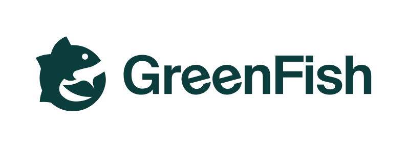

  <picture>
    <source media="(prefers-color-scheme: dark)" srcset="./logo-white.svg">
    <source media="(prefers-color-scheme: light)" srcset="./logo-green.svg">
    
  </picture>

<h2 align="center">Precision fishing</h2>

<strong>The world's most accurate fishing intelligence.</strong>

  GreenFish' predictive fishing intelligence software is the most accurate on the market. It forecasts catch data up to eight days in advance, and improves every trip, with each fishery's own data no one else can access. Captains always remain in charge while GreenFish backs their decisions with actionable recommendations.

  Founded in 2023 in Reykjavík, GreenFish works with fleets across the world.

  <a href="https://greenfish.is">greenfish.is</a>

